# POKE MNKY v2 — App Review (2026-11-02)

**Live:** https://poke-mnky.moodmnky.com  
**Repo:** MOODMNKY-LLC/POKE-MNKY-v2 @ `main` (includes PRs #13–#19)  
**Audience:** Matt (league organizer) + Simeon (developer)  
**Scope:** Read-only review of public, coach, and admin surfaces; APIs; crons; league data paths. No app code changes in this PR.

**Roles (context):** Simeon builds the app. Matt defines purpose, user flows, and what “done” means for the league. Matt has run Average at Best for years from the Google Sheet; the plan is to migrate the sheet’s purpose into the app gradually. Today Season 7 competitive data is heavily sheet-driven via the daily sync (#15 / #19).

---

## How the app, Discord and the sheet work together

*Written for Matt — plain language.*

### The short version

| System | What it is the source of truth for **today** |
|--------|-----------------------------------------------|
| **Google Sheet** | Season 7 standings, schedule & results, kill/MVP lines, draft picks & drops, free-agency notes, playoff seeds, Tera captains. Coaches and Matt still enter results and roster moves here. |
| **The app** | Showing that Season 7 data to fans and coaches; coach Showdown teams & tools; draft pool / Season 8 draft ops; admin controls; Discord account linking. The app **reads** the sheet every morning and **copies** league data into its database. |
| **Discord** | Where coaches post battle results and talk league. The app **reads** the results channel once a day and flags mismatches for review. It does **not** change standings or scores from Discord posts. |

### What moves where, and when

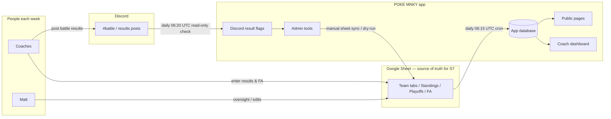

1. **During the week:** Coaches play matches, update the sheet (scores, lineups/kills, FA), and usually post in Discord too.
2. **Every morning ~06:15 UTC:** The app copies the sheet into the database (standings numbers, matches, kills, rosters, FA audit, seeds). If the sheet’s “Standings For Playoffs” doesn’t match what the app would compute, the sync **stops and does not write** (blocked).
3. **~Five minutes later (~06:20 UTC):** The app scans Discord battle posts and marks “looks right / needs review.” It **never writes** match scores, kills, or team records from Discord.
4. **What the Discord check never does:** Update matches, pokemon kill stats, or teams. Sheet sync is the only automated writer for those Season 7 competitive rows.
5. **When they disagree:** Prefer the **sheet**. Fix the sheet (or wait for Matt/Simeon to investigate). Discord flags are a second opinion for Simeon/Matt in Admin → Discord results — not a competing standings engine.
6. **Season 8 / draft:** Homepage countdown and draft tooling point at Season 8 (`is_current`). Live standings/MVP/schedule default to Season 7 (the sheet-synced season). That split is intentional right now.

### Who does what each week

| Who | What they do |
|-----|----------------|
| **Coaches** | Play games; update the sheet; optionally post results in Discord; use the app for Showdown teams, calc, draft prep, and viewing standings/schedule. |
| **Matt** | Owns league rules and “what should the app feel like”; decides when the sheet can stop being the master; reviews odd FA/trade/playoff edge cases. |
| **The app** | Shows Season 7 from the morning copy; runs the two daily jobs; hosts draft/admin/Showdown tools; queues Discord mismatches for humans. |
| **Simeon** | Keeps sync healthy, fixes bugs, builds the next migration steps Matt prioritizes. |

---

## 1. Inventory

Status key: **Live** = works on production with Season 7 data · **Partial** = loads but incomplete/wrong season/thin data · **Legacy** = older path overlapping sheet-sync · **Unused/orphan** = little evidence of active league use · **Action** = keep / retool / refactor / redesign / remove · **Effort** = S / M / L

### Public pages

| Route | What it does today | Live S7? | vs sheet-sync | Action | Effort |
|-------|-------------------|----------|---------------|--------|--------|
| `/` | Marketing home, draft countdown (S8), live-data strip | Partial — countdown S8; team strip uses **current** season (S8 unassigned), not live S7 | Conflicts with standings season picker | **Retool** homepage live strip to live season | S |
| `/standings` | Sheet-exact overall + division tables | **Live** — Kalamazoo 6-2 etc. | Aligned (`v_regular_team_rankings`) | **Keep** | — |
| `/teams` | Team directory | Live teams; W/L from `teams` columns | Can drift vs standings view | **Retool** sort/source to rankings view | S |
| `/teams/[id]` | Team page: record, roster, FA, schedule | Live | Dual roster UIs (current + by-week) | **Refactor** roster to one path | M |
| `/schedule` | Weekly match cards | Live (played = `completed`) | Aligned | **Keep** | — |
| `/matches` | Match Center browser | Live | Status badges still show raw statuses | **Keep** / polish | S |
| `/playoffs` | Bracket from matches + bye flags | Live — R1/QF populated | Seeds from sheet; bracket UI thin | **Retool** seed labels + clearer TBD | M |
| `/mvp` | KO leaderboard | Live — Deoxys 17 etc. | From `pokemon_stats` | **Keep** | — |
| `/insights` | Weekly trends client UI | Partial / thin | Overlaps MVP/standings | **Redesign or remove** | M |
| `/draft`, `/draft/board` | Draft marketing + board | S8/draft oriented | Not S7 sheet board | **Keep** for next draft | — |
| `/draft/room` | Coach shortlist (auth) | Draft prep | — | **Keep** | — |
| `/pokedex`, `/calc`, `/showdown/*` | Reference & Showdown tools | Works as tools | Orthogonal to sheet | **Keep** | — |
| `/videos` | Gallery | Content-dependent | — | **Keep** if used | S |
| `/matches/submit` | Public result submit | Exists | **Competes** with sheet-as-SoT | **Remove or gate** until app is SoT | S |
| `/privacy-policy`, `/terms`, `/offline` | Legal / PWA | Fine | — | **Keep** | — |
| `/apply/coach` | Coach application | Works | — | **Keep** | — |
| `/auth/*`, `/verify-user*` | Login / Discord verify | Works | — | **Keep** | — |
| `/profile` | Profile | Works | Overlaps dashboard settings | **Refactor** into dashboard | S |

### Coach / dashboard

| Route | What it does | Live use vs sheet | Action | Effort |
|-------|--------------|-------------------|--------|--------|
| `/dashboard` | Coach home | Useful shell; mixed S7/S8 signals | **Redesign** IA (see §2) | M |
| `/dashboard/onboarding` | Checklist | Valuable for new coaches | **Keep** | — |
| `/dashboard/stats`, `/activity` | Stats / audit | Low signal | **Retool** or fold into home | S |
| `/dashboard/league-team`, `/roster` | Claimed league team | Roster may lag sheet until sync | **Keep**; single roster source | M |
| `/dashboard/free-agency` | In-app FA system | **Parallel** to sheet FA / `transaction_audit` | **Retool** — read sheet FA until write moves | L |
| `/dashboard/trade-block` | Trade listings | Parallel to sheet/Discord process | **Product decision** (Matt) | M |
| `/dashboard/weekly-matches*` | Prep + submit + history | Submit path vs sheet SoT | **Retool** submit → “report only” or sheet link | M |
| `/dashboard/draft*` | Planning / board / roster | Next-season oriented | **Keep** | — |
| `/dashboard/teams*` | Showdown teams | Strong, independent of sheet | **Keep** | — |
| `/dashboard/settings`, guides | Account + docs | Guides buried / redirects | **Refactor** | S |
| `/dashboard/claim-team` | Redirect | Fine | **Keep** | — |

### Admin

| Route | What it does | Notes | Action | Effort |
|-------|--------------|-------|--------|--------|
| `/admin` | Hub | Fine | **Keep** | — |
| `/admin/league` | Teams / matches / stats / sync logs / countdown | Primary league ops | **Keep**; clarify season flags | S |
| `/admin/sheet-sync` | Manual / dry-run league sheet sync | **Not in sidebar nav** | **Keep** + add to nav | S |
| `/admin/google-sheets` | Legacy Data-tab / multi-tab sync | Overlaps / confuses with sheet-sync | **Retool** label: “legacy team metadata” or retire | M |
| `/admin/discord`, `…/results` | Bot + Discord reconcile flags | Results page easy to miss | **Keep**; link from League | S |
| `/admin/playoffs` | Generate / advance bracket | Can fight sheet seeds | **Gate** while sheet owns seeds | M |
| `/admin/trades` | Approve trades | Parallel process | Matt decide | M |
| `/admin/draft/*`, draft-pool*, pokemon | Draft ops | Needed for S8 | **Keep** | — |
| `/admin/sync`, pokepedia, simulation, music | Infra / content | Simulation ≠ live league | **Keep** sim labeled; music optional | S |
| `/admin/coach-applications`, `/users` | People ops | Applications not in main League group | **Keep**; fix nav | S |
| Redirect husks (`/admin/matches` → hash, etc.) | Compatibility | OK | **Keep** briefly | S |

### Crons (`vercel.json`)

| Schedule (UTC) | Route | Writes? | Action |
|----------------|-------|---------|--------|
| `0 3 * * *` | `/api/cron/sync-pokemon` | Catalog/cache | Keep |
| `0 5 * * 1` | `/api/cron/execute-transactions` | Pending FA/trades in app | **Review** vs sheet FA SoT |
| `15 6 * * *` | `/api/cron/sync-league-sheet` | Season 7 competitive rows via RPC | Keep (critical) |
| `20 6 * * *` | `/api/cron/reconcile-discord-results` | Flags only | Keep |

### Key DB / sync objects

| Object | Role | Action |
|--------|------|--------|
| `seasons.sheet_sync_enabled` / `sheet_spreadsheet_id` | Which season cron may write | Keep; document for Matt/Simeon |
| `seasons.is_current` | Draft / “current” season (S8) | Keep; stop using for live standings |
| `matches` / `pokemon_stats` / `draft_picks` + `source` | Sheet-owned vs app-owned rows | Keep |
| `v_regular_team_rankings` | Standings order for `/standings` + sync gate | Keep |
| `playoff_seeds`, `transaction_audit`, `v_public_free_agency` | Seeds + public FA | Keep |
| `sheet_sync_runs`, `sheet_sync_apply*` | Sync audit + apply | Keep |
| `google_sheets_config` / legacy sync | Older ingest | Retire or quarantine |
| `lib/league-sheet/*` vs `lib/sheet-sync/*` | Duplicate planners | Consolidate → sheet-sync only |

### API surface (summary)

~190 `app/api` routes. Critical public: `/api/standings`, `/api/matches`, `/api/homepage/*`. Critical write: cron sheet sync + Discord reconcile. Large clusters: Discord bot helpers, admin draft pool, AI assistants, free-agency/trade, Showdown teams. Many AI/Discord/admin routes are fine but increase maintenance; prioritize by Matt’s migration order (§6).

---

## 2. UI/UX review

### Screenshots (public, live Season 7)

| Page | File |
|------|------|
| Home | 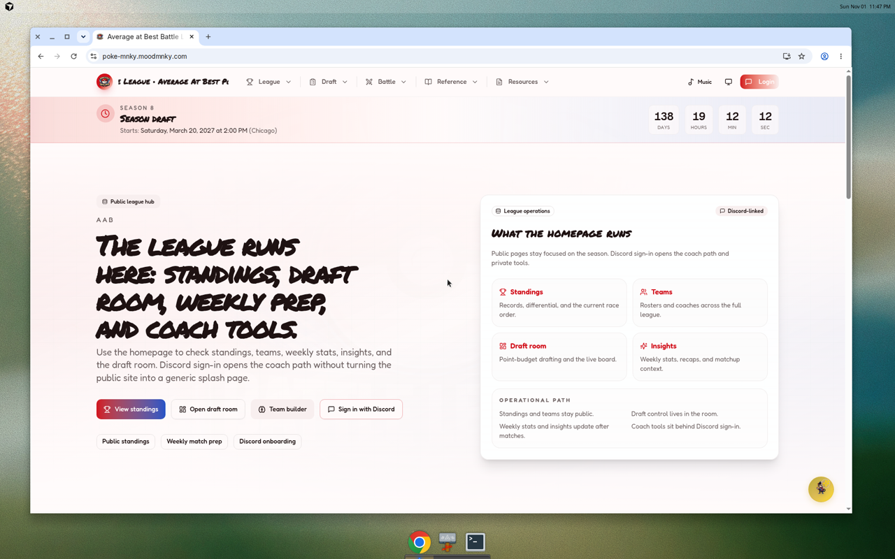 |
| Standings | 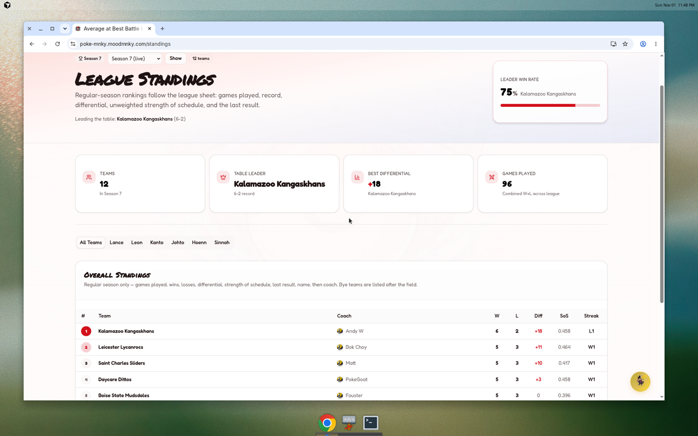 |
| Teams | 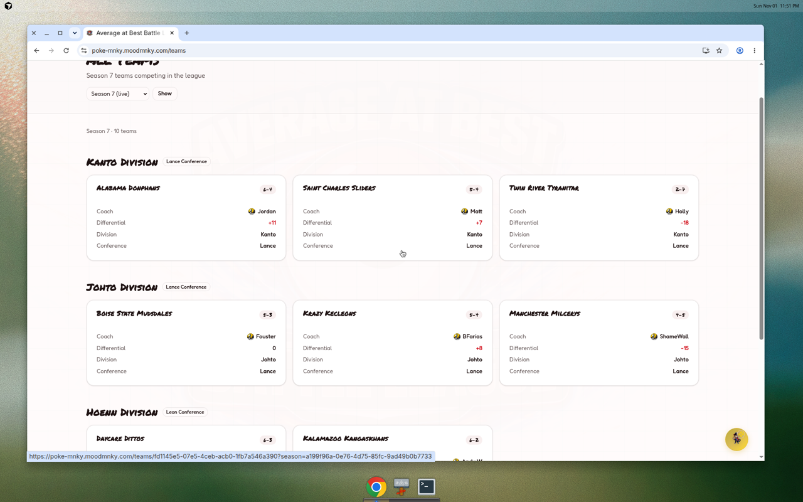 |
| Team detail | 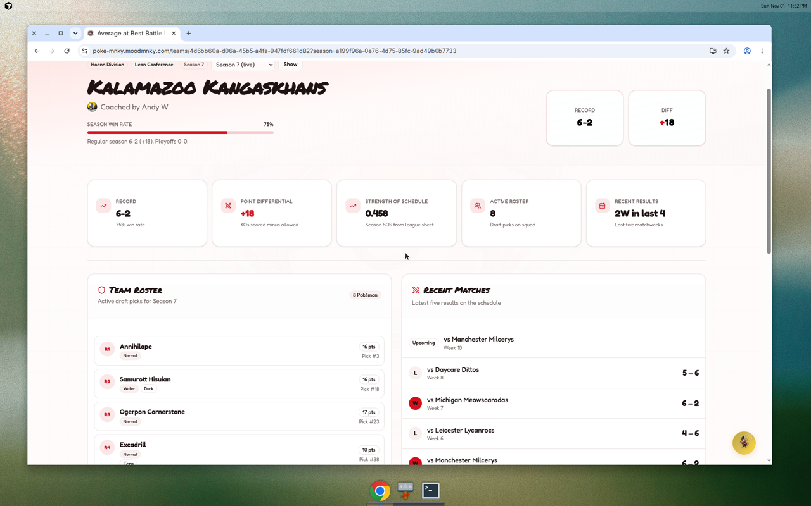 |
| Matches | 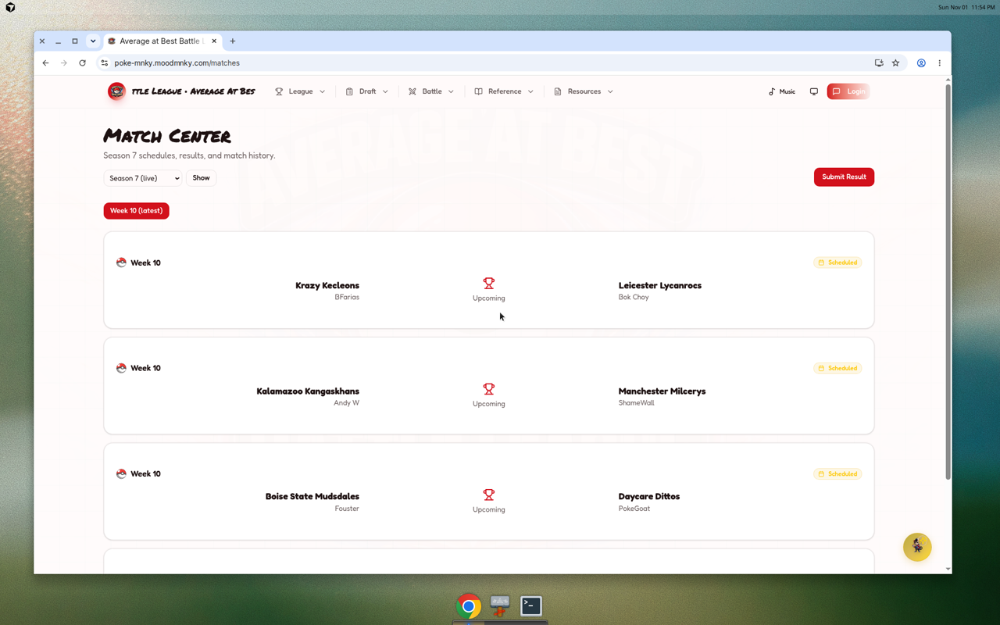 |
| Playoffs | 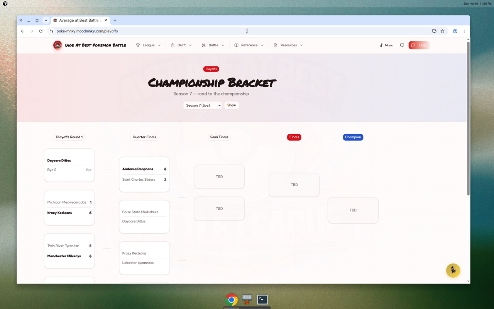 |
| MVP | 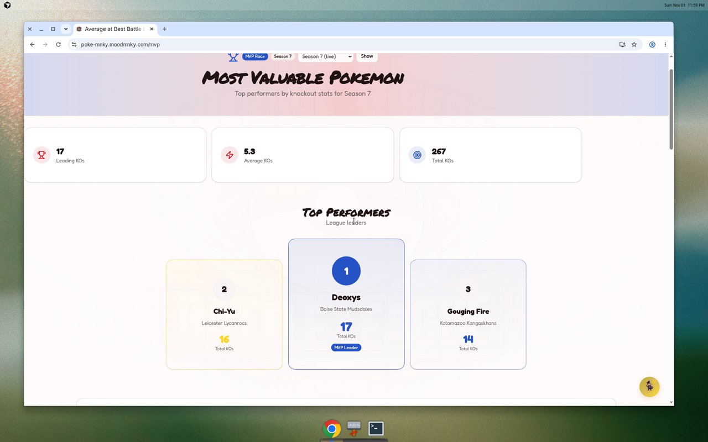 |
| Draft / board | 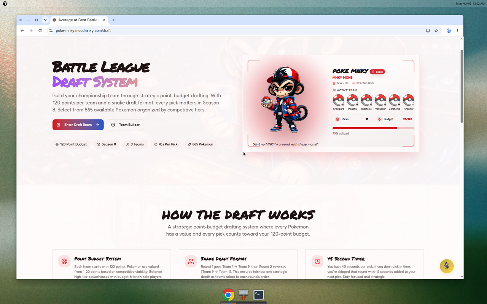 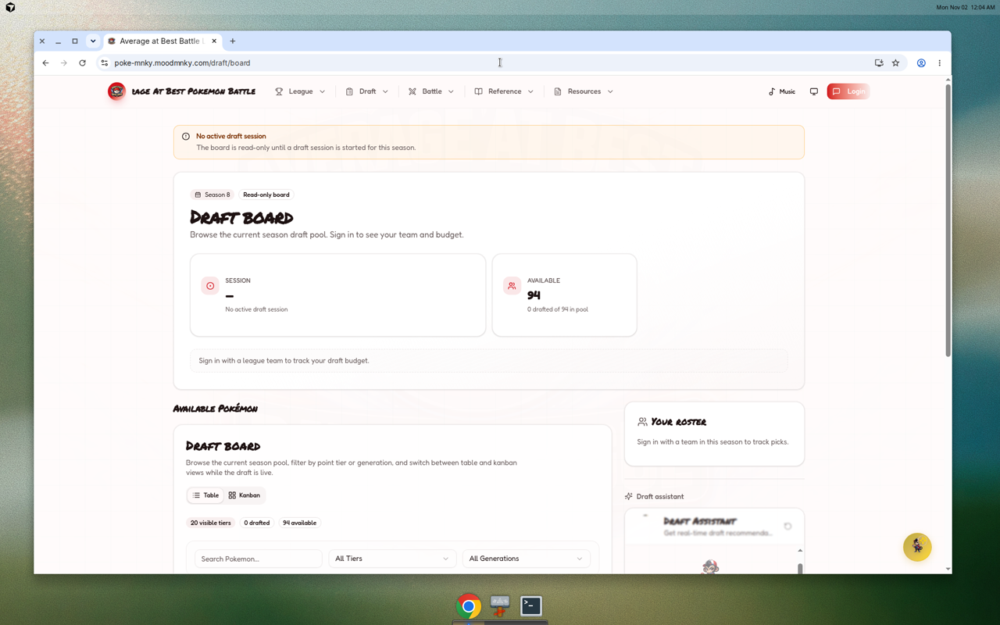 |
| Home (mobile ~390px) | 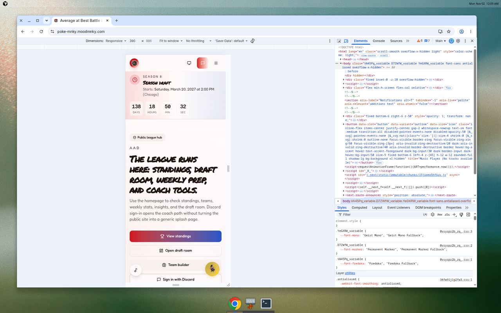 |

### Public IA and consistency

- **Works well:** `/standings`, `/mvp`, `/schedule` clearly Season 7 and sheet-aligned; season switcher on standings.
- **Confusing:** Homepage strip shows Season 8 “Unassigned” coaches while standings are Season 7; Match Center vs Schedule overlap; Insights vs MVP unclear; playoffs TBD slots without seed numbers.
- **Polish:** Standings hero repeats the leader many times; public header + dashboard dock + FAB compete for attention; mobile homepage stacks hero/countdown well but still inherits the S8-vs-S7 content mismatch.
- **A11y basics:** Prefer real tables with captions; ensure season controls are labeled; don’t rely on color alone for W/L streaks.

### Coach / player dashboard — current

**Sidebar today (`AppSidebar`):**

1. **Dashboard** — Overview, Onboarding, My Stats, Activity  
2. **Teams** — My Teams, Library, Create, Upload, Builder *(Showdown — not league roster)*  
3. **My League Team** *(coaches)* — View Team, Roster, Free Agency, Trade Block, Team Stats  
4. **Draft** — Planning, Board, My Roster  
5. **Damage Calculator**  
6. **Weekly Matches** — All, Submit Result, History  
7. **Settings** — Account, notifications, guides  

**Also:** bottom **DashboardDock** (Home / Standings / Teams / Schedule / Draft / Showdown / Pokédex / Insights), Tera modal, command palette.

**What’s redundant / confusing / unused**

| Issue | Why it hurts |
|-------|----------------|
| “Teams” vs “My League Team” | Coaches think Showdown paste teams are their league roster |
| Free Agency + Trade Block + Weekly Submit | Look like app is SoT; sheet still is |
| Team Stats → redirects / thin | Dead-end |
| Draft Planning vs public `/draft` | Duplicate mental model |
| Dock + sidebar + site header | Three nav systems |
| Guides as settings redirects | Hard to discover |
| Activity feed | Low value vs sheet/Discord |

**Proposed streamlined coach layout**

| Nav group | Items | Intent |
|-----------|-------|--------|
| **Home** | Overview (this week’s match, record, sync “as of” time, onboarding checklist if incomplete) | One glance |
| **My team** | Roster (read-only from sheet sync), schedule, Tera | League truth |
| **This week** | Prep notes / battle plan only — result submit becomes “Post in Discord + update sheet” helper, not DB write | Match week |
| **Showdown toolbox** | Teams library, builder, upload, calc | Tools |
| **Draft** *(when draft season)* | Board + shortlist | Next season |
| **Account** | Profile, Discord link, notifications, guides | Settings |

Hide or feature-flag in-app FA / trade **writes** until Matt says the app owns them. Keep **read** of public FA from sheet audit.

### Admin dashboard — current

**Sidebar today (`AdminAppSidebar`):**

1. **Overview**  
2. **League** — Hub, Teams, Matches, Homepage countdown, Trades, Draft Pool & Rules, Draft Sessions, Draft Board, Playoffs  
3. **Sync & Data** — Sync Hub, Sync Logs *(Pokepedia-oriented; not league sheet)*  
4. **System** — Users, Pokepedia, Pokemon Catalog  
5. **Integrations** — Discord, Google Sheets, Simulation, Music  
6. Season switcher (by `is_current`, not sheet-sync flag)

**Missing from nav (but pages exist):** `/admin/sheet-sync`, `/admin/discord/results`, `/admin/coach-applications`, draft-pool-builder.

**What’s redundant / dangerous**

| Issue | Risk |
|-------|------|
| Google Sheets vs Sheet Sync | Two sync UIs; wrong button can write legacy paths |
| Admin Playoffs generate vs sheet seeds | Can diverge from sheet |
| Simulation under Integrations | Looks like live ops |
| Season switcher = `is_current` | Admins edit S8 while watching S7 live |
| Sync Logs ≠ sheet_sync_runs | Wrong log for “did morning sync work?” |

**Proposed streamlined admin layout**

| Nav group | Items |
|-----------|--------|
| **Today** | Sheet sync (dry-run / run / last `sheet_sync_runs`), Discord result flags, countdown |
| **Season 7 (live)** | Teams, Matches, Standings preview, Playoffs *(view)* , FA audit |
| **People** | Users, Coach applications, Discord roles |
| **Next draft (S8)** | Draft pool, sessions, board, pokemon catalog |
| **Platform** | Pokepedia sync, storage, music, simulation *(clearly “test data”)* |
| **Legacy** | Old Google Sheets Data-tab sync *(collapsed / warning)* |

---

## 3. Code and architecture

### Dead / duplicate logic

- **`lib/sheet-sync/*`** (cron) vs **`lib/league-sheet/*`** + `scripts/sync-league-sheet.ts` — same problem, two codebases.  
- **`lib/google-sheets-sync.ts`** — legacy Admin sync; still writable; not covered by sheet-sync tests.  
- **Standings:** view `v_regular_team_rankings` vs denormalized `teams.wins` vs `updateStandingsFromMatches` on app result completion — three writers conceptually.  
- **Rosters:** `draft_picks` (sheet) vs `team_rosters` vs `team_roster_versions` vs google-sheets team-page sync.  
- **FA:** sheet `transaction_audit` / `v_public_free_agency` vs `/api/free-agency/*` + Monday `execute-transactions` cron.

### Data-path conflicts (highest risk)

1. Homepage `live-data` uses **current** season; standings use **sheet-synced** season.  
2. In-app match submit / simulation / playoff generate can rewrite rows sheet sync also owns.  
3. Discord reconcile is safe (flags only); good pattern — keep other writers as cautious.

### Schema leftovers

- `is_live_competitive` alongside `sheet_sync_enabled` (compat layer — OK short-term).  
- `google_sheets_config` + `sync_jobs` mixed with `sheet_sync_runs`.  
- Bye teams as real `teams` rows (correct for sheet parity; document for UI).

### Tests

- **Strong:** sheet-sync acceptance + ambiguous-column Postgres job (#19); sheet-standings; match-display; standings-season.  
- **Gaps:** legacy google-sheets sync; no e2e that homepage season == standings season; FA write paths; admin playoff generate vs sheet seeds.

### Performance

- Public standings/MVP fine at S7 scale.  
- `/insights` and heavy client dashboards may over-fetch — revisit if kept.  
- Cron sheet sync should stay one-season, advisory-locked (already).

### Security

- `/admin` and `/dashboard` gated in `proxy.ts` (login); **role checks in page/API**, not edge — verify every admin API uses `requireLeagueAdmin` (or equivalent).  
- Cron: Bearer `CRON_SECRET`.  
- Sheet sync: service role + RPC grants to `service_role` only — good.  
- Never commit secrets; review env examples only.  
- Discord bot secrets / internal headers documented in AGENTS.md — keep out of fixtures (already audited in sheet-sync tests).

---

## 4. Sheet-to-app migration map

Goal: app becomes source of truth **when Matt says so**, feature by feature.

| Sheet function | App covers today | Gap to app-as-SoT | Effort |
|----------------|------------------|-------------------|--------|
| **Standings** | Display + SQL rankings; sync verifies vs sheet | Stop denormalized dual writes; coaches stop editing sheet standings | M |
| **Schedule & results** | Display; upcoming = not `completed` | In-app result entry with audit, Discord optional mirror, disable sheet score edits | L |
| **MVP / kills** | `/mvp` from `pokemon_stats` | Lineup/kill entry UI per match; sheet lineups become export | L |
| **Rosters & points** | `draft_picks` display; points snapshot | Single roster editor; week versions; point rules engine in app | L |
| **Free agency & trades** | Public FA read; dashboard FA/trade **parallel** | One workflow; Monday cron aligned; sheet FA tab becomes report | L |
| **Tera captains** | Modal / windows APIs | Enforce windows in app only; sheet column = mirror | M |
| **Playoffs & bracket** | Bracket view; admin generate | Seed UI from rankings; advance rounds in app; sheet bracket = export | M |
| **Draft board** | In-app draft sessions + Notion/n8n paths | One live board for S8+; sheet draft archive only | M |

**Suggested order (product):** Results entry → Rosters/FA → Playoffs → Kill lines → Sheet becomes read-only export.

---

## 5. Product questions for Matt

*Plain language — no engineering jargon.*

1. **When should coaches stop typing scores into the sheet?** Is Discord post + app submit enough, or do you still want the sheet as backup for a full season?  
2. **Should the public site feel like “Season 7 live league” first, or “Season 8 draft” first?** Right now the homepage leans draft/S8 while standings are S7.  
3. **Free agency:** Must adds/drops go through the app for rules enforcement, or is the sheet tab still the official log until next season?  
4. **Trades:** Do you want in-app approve/deny, or keep trades as a Matt/Discord process?  
5. **Bye teams:** Should fans see Bye 1 / Bye 2 in standings (sheet-accurate), or hide them on public pages?  
6. **Playoff bracket:** Do you want seed numbers and “who plays whom” explained like the sheet, or is the current visual bracket enough?  
7. **Insights page:** Keep and invest, merge into standings/MVP, or remove?  
8. **Coach dashboard:** Is Showdown team building the #1 coach job in-app, or is “my league roster + this week’s match” #1?  
9. **Who is allowed to press “apply sheet sync” besides the daily job?** Only Simeon, or you too?  
10. **Definition of done for “leave the sheet”:** Which one sheet tab disappearing first would make you trust the app?

---

## 6. Engineering backlog for Simeon

Batchable PRs, prioritized.

### P0 — trust & clarity (ship soon)

| PR | Scope | Effort |
|----|-------|--------|
| A | Homepage `live-data` + any “current season” public strips → `pickStandingsSeason` / live season | S |
| B | Add **Sheet Sync** + **Discord results** + **Coach applications** to admin nav; label legacy Google Sheets | S |
| C | Docs for Matt: “S7 = sheet sync, S8 = draft current” on admin league hub | S |
| D | Quarantine or feature-flag public/dashboard **match submit** writes while sheet is SoT | S |

### P1 — one data path

| PR | Scope | Effort |
|----|-------|--------|
| E | Delete or wrap `lib/league-sheet` behind `lib/sheet-sync` (one planner) | M |
| F | Team public list + team cards read rankings view (not raw `teams.wins` alone) | S |
| G | Single roster component on `/teams/[id]` (`draft_picks` primary) | M |
| H | Admin playoff **generate** disabled when `sheet_sync_enabled` season selected | S |

### P2 — coach/admin IA

| PR | Scope | Effort |
|----|-------|--------|
| I | Coach sidebar redesign per §2 (flag FA/trade writes) | M |
| J | Admin sidebar “Today / Live / Draft / Legacy” per §2 | M |
| K | Collapse Insights or redirect to MVP+standings pending Matt | S |

### P3 — migration toward app SoT (after Matt answers §5)

| PR | Scope | Effort |
|----|-------|--------|
| L | Result entry MVP: coach submits → `matches` + optional Discord notify; sheet sync becomes verify-only for scores | L |
| M | FA workflow unification (app write + audit; sheet export) | L |
| N | Playoff advance UX + seed table public | M |
| O | Kill/lineup entry tied to match | L |

---

## 7. Top 10 recommendations

1. **Treat the sheet as Season 7 SoT until Matt signs off tab-by-tab** — keep Discord read-only; don’t add competing writers.  
2. **Fix homepage season mismatch** (S8 strip vs S7 standings) — biggest public trust bug.  
3. **Put Sheet Sync + Discord result flags in the admin sidebar** — operators can’t manage what they can’t find.  
4. **Label/retire legacy Google Sheets sync** so nobody confuses it with morning league sync.  
5. **Simplify coach nav** around “my league team + this week,” with Showdown tools secondary.  
6. **One roster path** on public team pages.  
7. **Gate admin playoff generate / in-app result writes** on the sheet-synced season.  
8. **Consolidate `league-sheet` → `sheet-sync`** to cut dual maintenance.  
9. **Ask Matt the §5 questions before building FA/trade/result SoT** — avoids rework.  
10. **Migration order:** results → roster/FA → playoffs → kills → sheet export-only.

---

## Appendix — live spot-checks (2026-11-02, read-only)

- `/api/standings` → Season 7, Kalamazoo 6-2, 12 teams including byes.  
- `/api/matches` → S7 matches with `status: completed` etc.  
- `/api/homepage/live-data` → Season 8 teams, coaches “Unassigned”.  
- `/api/homepage/next-event` → Season 8 draft start 2027-03-20 Chicago.  
- `/mvp` → Deoxys 17 KOs; Chi-Yu 16; Gouging Fire 14.  
- `/playoffs` → Round 1 and some Quarter Finals filled; later rounds TBD.

---

*End of review. Screenshots under `docs/reviews/img/`. No secrets included.*
